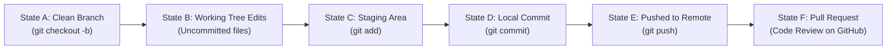

# Git & GitHub Workflow Demonstration Guide

This guide documents the real-world Git workflow used in this micro-project. It illustrates how professional software teams move from an Issue to a Branch, Code Edits, Tests, Commits, and a Pull Request.

---

## 🧭 The 6 Core Git States Demonstrated



### Deep Dive: Working Directory vs. Staging Area vs. History

| Git Stage | What It Contains | Where It Lives | Commands That Affect It |
| :--- | :--- | :--- | :--- |
| **1. Working Directory** | The actual files currently open on your hard drive | Your local folder | Direct file edits, `git restore` |
| **2. Staging Area (Index)** | The prepared draft of files queued for the next commit | `.git/index` | `git add <file>`, `git restore --staged` |
| **3. Git Commit History** | Permanent, cryptographically hashed snapshots of project state | `.git/objects` | `git commit -m "..."`, `git log` |

---

## 📝 Step-by-Step Workflow Walkthrough

### Step 1: Issue Definition
**Issue #1: Add health-check endpoint to Basic Greeting API**
- **Description:** Systems monitoring and load balancers require a dedicated health endpoint to check service status without executing business logic.
- **Acceptance Criteria:**
  - Implement `GET /health` returning `{"status": "ok"}`.
  - Return HTTP status `200 OK`.
  - Add automated test verifying the endpoint.
  - All test cases must pass.

---

### Step 2: Create Feature Branch (State A)
Branches isolate new feature development so the production `main` branch remains untouched and deployable.

```powershell
git checkout -b feature/health-check
git status
```

**Terminal Output:**
```text
Switched to a new branch 'feature/health-check'
On branch feature/health-check
nothing to commit, working tree clean
```
*At this point (State A), the branch points to the same commit as `main`. No changes exist.*

---

### Step 3: Implement Feature & Inspect Uncommitted Changes (State B)
We edited `project1_basic/main.py` to add `GET /health` and `project1_basic/test_main.py` to add `test_health_check`.

```powershell
git status
git diff
```

**Terminal Output (`git status`):**
```text
On branch feature/health-check
Changes not staged for commit:
  (use "git add <file>..." to update what will be committed)
  (use "git restore <file>..." to discard changes in working directory)
        modified:   project1_basic/main.py
        modified:   project1_basic/test_main.py

no changes added to commit (use "git add" and/or "git commit -a")
```

**Terminal Output (`git diff`):**
```diff
diff --git a/project1_basic/main.py b/project1_basic/main.py
--- a/project1_basic/main.py
+++ b/project1_basic/main.py
@@ -12,3 +12,9 @@ def read_root():
+# Health-check endpoint: Returns service health status
+@app.get("/health")
+def read_health():
+    """Health check endpoint to verify that the service is alive and healthy."""
+    return {"status": "ok"}
```
*At this point (State B), edits exist purely in the Working Directory. If you close your computer or delete the folder, Git cannot recover them.*

---

### Step 4: Run Automated Tests
Before staging or committing, professional developers always run automated tests:

```powershell
cd project1_basic
..\.venv\Scripts\python.exe -m pytest -v
```

**Terminal Output:**
```text
test_main.py::test_read_root PASSED                                      [ 33%]
test_main.py::test_health_check PASSED                                   [ 66%]
test_main.py::test_nonexistent_route PASSED                              [100%]
======================== 3 passed, 1 warning in 0.45s =========================
```
*All tests pass. The code is proven working.*

---

### Step 5: Stage and Commit Changes (States C & D)

#### Staging (State C)
```powershell
git add project1_basic/main.py project1_basic/test_main.py
git status
```
**Terminal Output:**
```text
On branch feature/health-check
Changes to be committed:
  (use "git restore --staged <file>..." to unstage)
        modified:   project1_basic/main.py
        modified:   project1_basic/test_main.py
```
*Files are now staged in the Index.*

#### Committing (State D)
```powershell
git commit -m "Add health check endpoint"
git status
git log -1 --oneline
```
**Terminal Output:**
```text
[feature/health-check ba534f3] Add health check endpoint
 2 files changed, 12 insertions(+)
On branch feature/health-check
nothing to commit, working tree clean
ba534f3 Add health check endpoint
```
*A new snapshot is permanently recorded in the local repository.*

---

### Step 6: Pushing to Remote (State E)
To share the branch with team members or a remote GitHub server:

```powershell
# If remote is already added:
git push -u origin feature/health-check
```

**Attaching GitHub Remote (if connecting for the first time):**
```powershell
git remote add origin https://github.com/<your-username>/<repo-name>.git
git push -u origin main
git push -u origin feature/health-check
```

---

### Step 7: Preparing the Pull Request (State F)

Once pushed, open GitHub and create a Pull Request:
- **Base branch:** `main`
- **Compare branch:** `feature/health-check`

#### PR Specification:
- **Title:** `Add health-check endpoint to Basic Greeting API`
- **Body:**
  ```markdown
  ## 🚀 Summary of Changes
  - Added `GET /health` endpoint returning `{"status": "ok"}` with HTTP status `200 OK`.
  - Added unit test `test_health_check` in `test_main.py` using `fastapi.testclient.TestClient`.
  - Verified OpenAPI schema generation at `/docs`.

  ## 🧪 Testing Results
  - Command: `python -m pytest -v`
  - Output: 3 passed in 0.45s (Root, Health Check, Nonexistent 404).

  ## 🔗 Issue Reference
  Closes #1
  ```
- **Note:** The keyword `Closes #1` automatically marks Issue #1 as completed when the Pull Request is merged.
